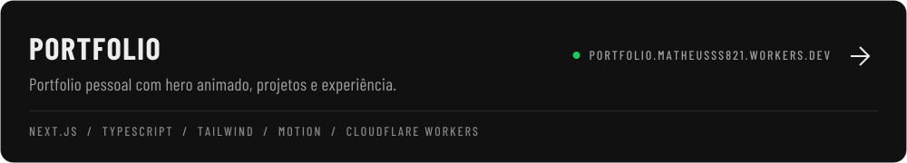

<picture><source media="(prefers-color-scheme: dark)" srcset="assets/banner-dark.svg"><source media="(prefers-color-scheme: light)" srcset="assets/banner-light.svg"></picture>

 

&nbsp;
&nbsp;

 

## Sobre

Desenvolvedor Full Stack com foco em **back-end, arquitetura e sistemas distribuídos**. Gosto de transformar domínios complexos em software limpo, observável e fácil de evoluir — de APIs com DDD a interfaces que operam usinas solares em tempo real.

 

## Trajetória

<table>
<tr><td width="230" valign="top"><b>ATI</b> · Full Stack  jul/2026 — atual</td><td valign="top">Supervisório de usinas solares (Geração Distribuída) com <b>agente de IA</b> e <b>Gêmeo Digital</b> para monitoramento e operação.</td></tr>
<tr><td width="230" valign="top"><b>Porto Digital</b> · Líder de squad  Recrutamento</td><td valign="top">Liderança técnica de squad no desenvolvimento de um <b>ecossistema de recrutamento</b>.</td></tr>
<tr><td width="230" valign="top"><b>CBMSE</b> · Back-end  Corpo de Bombeiros de Sergipe</td><td valign="top">API com <b>DDD e Clean Architecture</b>, CI/CD com <b>Jenkins</b>, autenticação via <b>Keycloak</b> e cache com <b>Redis</b>.</td></tr>
<tr><td width="230" valign="top"><b>Bonsae</b> · Back-end  Laravel</td><td valign="top">Relatórios <b>assíncronos</b> com mais de <b>20 mil linhas</b>, eliminando timeouts em produção.</td></tr>
<tr><td width="230" valign="top"><b>Unit / LACEN</b> · Front-end  Vue.js</td><td valign="top">Interfaces em <b>Vue</b> para o sistema do Laboratório Central.</td></tr>
</table>

 

## Em destaque

<a href="https://portfolio.matheusss821.workers.dev">
<picture><source media="(prefers-color-scheme: dark)" srcset="assets/card-portfolio-dark.svg"><source media="(prefers-color-scheme: light)" srcset="assets/card-portfolio-light.svg"></picture>
</a>

  

## Stack

<table>
<tr><td width="120"><b>BACK-END</b></td><td><picture><source media="(prefers-color-scheme: dark)" srcset="https://skillicons.dev/icons?i=java,spring,php,laravel,nodejs,ts&theme=dark&perline=8"><source media="(prefers-color-scheme: light)" srcset="https://skillicons.dev/icons?i=java,spring,php,laravel,nodejs,ts&theme=light&perline=8"></picture></td></tr>
<tr><td><b>FRONT-END</b></td><td><picture><source media="(prefers-color-scheme: dark)" srcset="https://skillicons.dev/icons?i=react,vue,nextjs,tailwind,html,css&theme=dark&perline=8"><source media="(prefers-color-scheme: light)" srcset="https://skillicons.dev/icons?i=react,vue,nextjs,tailwind,html,css&theme=light&perline=8"></picture></td></tr>
<tr><td><b>DADOS</b></td><td><picture><source media="(prefers-color-scheme: dark)" srcset="https://skillicons.dev/icons?i=postgres,mysql,redis,rabbitmq&theme=dark&perline=8"><source media="(prefers-color-scheme: light)" srcset="https://skillicons.dev/icons?i=postgres,mysql,redis,rabbitmq&theme=light&perline=8"></picture></td></tr>
<tr><td><b>DEVOPS</b></td><td><picture><source media="(prefers-color-scheme: dark)" srcset="https://skillicons.dev/icons?i=docker,azure,githubactions,jenkins,git,linux&theme=dark&perline=8"><source media="(prefers-color-scheme: light)" srcset="https://skillicons.dev/icons?i=docker,azure,githubactions,jenkins,git,linux&theme=light&perline=8"></picture></td></tr>
</table>

 

## Atividade

<picture><source media="(prefers-color-scheme: dark)" srcset="https://github-readme-stats.vercel.app/api?username=mts1lva&show_icons=true&count_private=true&include_all_commits=true&rank_icon=github&locale=pt-br&custom_title=Estat%C3%ADsticas&theme=transparent&hide_border=true&title_color=EDEDED&text_color=A1A1A1&icon_color=D4D4D8&bg_color=00000000"><source media="(prefers-color-scheme: light)" srcset="https://github-readme-stats.vercel.app/api?username=mts1lva&show_icons=true&count_private=true&include_all_commits=true&rank_icon=github&locale=pt-br&custom_title=Estat%C3%ADsticas&hide_border=true&title_color=0A0A0A&text_color=52525B&icon_color=3F3F46&bg_color=00000000"></picture>
<picture><source media="(prefers-color-scheme: dark)" srcset="https://github-readme-stats.vercel.app/api/top-langs/?username=mts1lva&layout=compact&langs_count=8&locale=pt-br&custom_title=Linguagens&theme=transparent&hide_border=true&title_color=EDEDED&text_color=A1A1A1&icon_color=D4D4D8&bg_color=00000000"><source media="(prefers-color-scheme: light)" srcset="https://github-readme-stats.vercel.app/api/top-langs/?username=mts1lva&layout=compact&langs_count=8&locale=pt-br&custom_title=Linguagens&hide_border=true&title_color=0A0A0A&text_color=52525B&icon_color=3F3F46&bg_color=00000000"></picture>

<picture><source media="(prefers-color-scheme: dark)" srcset="https://streak-stats.demolab.com?user=mts1lva&locale=pt_BR&date_format=M%20j%5B%2C%20Y%5D&background=00000000&hide_border=true&ring=D4D4D8&fire=EDEDED&currStreakNum=EDEDED&sideNums=EDEDED&currStreakLabel=D4D4D8&sideLabels=A1A1A1&dates=737373&stroke=262626"><source media="(prefers-color-scheme: light)" srcset="https://streak-stats.demolab.com?user=mts1lva&locale=pt_BR&date_format=M%20j%5B%2C%20Y%5D&background=00000000&hide_border=true&ring=27272A&fire=0A0A0A&currStreakNum=0A0A0A&sideNums=0A0A0A&currStreakLabel=27272A&sideLabels=52525B&dates=71717A&stroke=E4E4E7"></picture>

